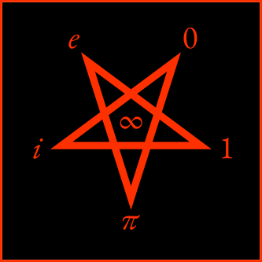

Title: The vice of virtù
Subtitle: Satanic Paganini
Author: impurify
Date: 2026-10-11
Impure-Byline: 1
Published: 2026-10-11
Version: v0.1.0

<figure id="evileipi" style="display: block; float: left; margin-right: 0.666em; margin-left: 0; max-width: min(20.8125em, 98vw);">

<figcaption><strong>Figure&nbsp;1: Thumbnail of “Evileipi” Paganini cover art <abbr title="copyright">©</abbr>&nbsp;2025, 2026 by <a href="https://impurify.com/" title="impurify: “The Antidote to Purity Culture™.”" referrerpolicy="no-referrer-when-downgrade">impurify</a>. All rights reserved.</strong>  So <em>evil!</em></figcaption>
</figure>

Once upon a time, there was a violinist so great, rumors swirled that his *virtù* was a gift from the Devil.  To some folks, his talent *could not* be natural:  They needed to *denaturalize* it, to render it *inhuman*, to identify it as *wrong*.

Niccolò Paganini was lucky:  He didn’t live in the age of [<abbr title="Large Language Model" class="smallcap">LLM</abbr> vampires][ai-vampires].  Although his live performances could not have been [defamed as <abbr title="Large Language Model" class="smallcap">LLM</abbr> slop][ai-libel-lawyer], a musician’s audiorecordings and compositions potentially could—and that susceptibility seems likely to grow, as <abbr title="Large Language Model" class="smallcap">LLM</abbr>s expand to do to music what they’ve done to prose and to images.

Moreover, to be accused of Satanism wreathes one in *evil:*  It does not make one *bad*.  Ask Professor Nietzsche to explain the difference.[^nietzsche-dual-dichotomy]  As such, the charge of Satanism is not *discrediting*, but rather, free advertising—and the mark of historic greatness!

[ai-vampires]: ../ai/vampires.html "impurify (2026-10-01). “‘AI’ Vampires and the Death of Texts”. *Dirt Under the Rug."

[ai-libel-lawyer]: ../personals/ai-defamation-lawyer.html "impurify (2026-09-30). “Seeking clueful Net lawyer re ‘AI’ defamation: Want an interesting case with an “AI” angle?”. *Dirt Under the Rug."

[^nietzsche-dual-dichotomy]: Friedrich Nietzsche (1886), *Beyond Good and Evil*, Aphorism 260.

Yea, the rumors of Satanism make Paganini cool like a rock star—and so hot, I’m jealous of Pauline Bonaparte.[^hot-pauline]

[^hot-pauline]:
    Pauline was an impurified princess, and she had sex with Paganini.

    To people who know not hereof I speak, I need for now to punt Pauline questions generally to [her *Wikipedia* article][wiki-pauline].  I should later revise this footnote to add information.

[wiki-pauline]: https://en.wikipedia.org/wiki/Pauline_Bonaparte "*Wikipedia:* “Pauline Bonaparte”."

In the era of Marilyn Manson, I was a teenager with a lust for the violin.  I loved to repeat a story I’d read about how people had whispered:  <em>Someone had <em>actually, literally seen</em> a devil sitting on Paganini’s shoulder, guiding him as he played!</em>  Given that I don’t believe in [adult fairytales](../neology/gloss.html#adult-fairytales){ .glosslink }, that’s no different than invoking Santa Claus—except that it’s oh, so much funner.  Wherefore late last year, when I was on a Paganini listening jag, I made Satanic cover art for my collection of Paganini’s Caprices.  For example, lo! behold <a href="#evileipi">Figure&nbsp;1</a>:  When read evilly counterclockwise as if playing a record backwards, this cover art blesses/curses Paganini’s soul for eternity with one of the most *fearsomely* beautiful of all equations, \\( e^{\htmlClass{scarlet}{i}\pi} + 1 = 0 \\).

The foregoing began as a tangent in an article on another topic.  It barely scratches the surface of *the vice of virtù*.  I will let it stand for now, as if a blog post; perhaps it may be a living document, or else, in time, it may presage an article to come.
